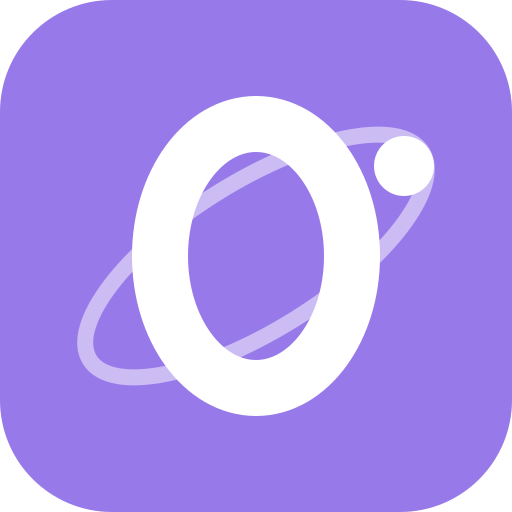
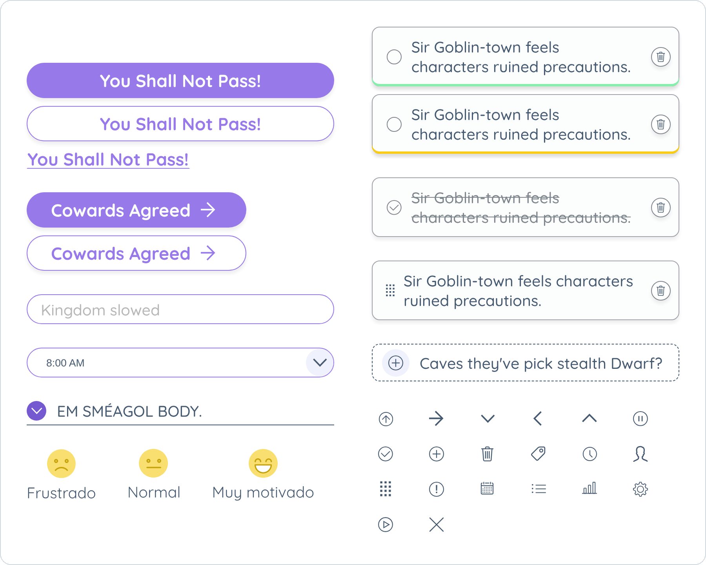
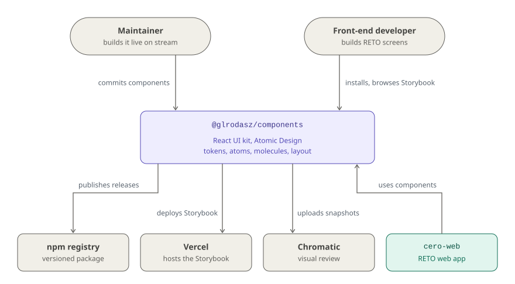

<!-- Logo slot: add docs/assets/logo.svg, then uncomment this line and the <br clear="left"> below the badges. -->
<!-- "> -->

# Cero a Producción — Components

**The React UI kit behind the RETO productivity app: 26 Atomic Design components on 337 CSS design tokens.**

[](https://github.com/glrodasz/cero-components/actions/workflows/release.yml) [](https://app.codecov.io/gh/glrodasz/cero-components) [](https://www.npmjs.com/package/@glrodasz/components) [](https://github.com/semantic-release/semantic-release) [](https://cero-components.vercel.app)

<!-- <br clear="left"> -->

[**Storybook**](https://cero-components.vercel.app) · [npm](https://www.npmjs.com/package/@glrodasz/components) · [How it works](#how-it-works) · [Architecture](#architecture) · [Quick start](#quick-start) · [Changelog](CHANGELOG.md)



0️⃣ 🚀 **Cero a Producción** is a series of live coding sessions where we build
**RETO**, a productivity app, from scratch to production — real decisions,
failing tests, refactors and all. This package is its UI layer, published to npm
as `@glrodasz/components` and consumed by [`cero-web`](https://github.com/glrodasz/cero-web).

📺 [YouTube](https://glrz.me/youtube-cero) · 🟣 [Twitch](https://glrz.me/stream)
(live in 🇪🇸 Spanish, Tuesdays to Fridays) · Part of the [Cero a Producción project](https://github.com/glrodasz/cero).

## Why

An app built live on stream changes every week. If colors, spacing and the task card live
inside the app, every redesign is a hunt through pages. This kit keeps them in one place:
design decisions are **tokens**, and screens are assembled from small, tested components
that know nothing about RETO's data or routes.

- **One source for design decisions.** Colors, spacing, type and per-component values are
  defined once in [`tokens/index.js`](tokens/index.js) and shipped as CSS custom properties.
  Component styles use only `var(--…)`: there are no hard-coded colors in any component CSS.
- **Built in isolation.** Every component is developed, documented and reviewed in
  [Storybook](https://cero-components.vercel.app) before the app uses it.
- **Every story is a test.** All stories are rendered and snapshot-tested on each push, and
  visual changes are published to Chromatic for review.
- **Versioned like a real package.** Conventional commits drive semantic-release, which
  publishes to npm and writes the [CHANGELOG](CHANGELOG.md).

It is built for RETO and for people following the series. It is **not** a general-purpose
design system: the tokens are RETO's brand, there are no TypeScript types, and the package
ships its source untranspiled (see [Quick start](#quick-start)).

## Quick start

> `react` and `react-dom` (19) are peer dependencies and must be installed in your project.

#### 1. Installation

```bash
yarn add @glrodasz/components prop-types
```

The components import `prop-types`, so install it alongside the package.

#### 2. Using the library

Load the tokens and base styles once, then use any component:

```jsx
import '@glrodasz/components/styles/globals.css'
import '@glrodasz/components/styles/tokens.css'
import { ButtonIcon, Task } from '@glrodasz/components'

export default function Today() {
  return (
    <>
      <Task type="active" onCheck={({ isChecked }) => console.log(isChecked)}>
        Write the README
      </Task>
      <ButtonIcon icon="arrowRight" type="primary">
        Cowards Agreed
      </ButtonIcon>
    </>
  )
}
```

The tokens use the **Quicksand** and **Roboto Mono** fonts; load them from Google Fonts as
[`.storybook/preview-head.html`](.storybook/preview-head.html) does. Browse every available
component, prop and variant in the [Storybook](https://cero-components.vercel.app).

<details>
<summary><b>Bundler setup: the package ships source, not a build</b></summary>

`main` points at [`index.js`](index.js), and the components are plain `.js` files with JSX,
CSS Modules (`*.module.css`) and SVGs imported as React components (`./faces/sad.svg?react`).
Your bundler has to handle all three:

- **Next.js** (how `cero-web` does it): `transpilePackages: ['@glrodasz/components']`, plus a
  webpack rule that loads `*.svg` from JS files with `@svgr/webpack`.
- **Vite**: `@vitejs/plugin-react` with JSX enabled for `.js` files, and `vite-plugin-svgr`, as in
  this repo's [`vite.config.js`](vite.config.js).
- **Jest**: transform the package (`transformIgnorePatterns: ['node_modules/(?!@glrodasz/)']`),
  since its `@glrodasz/storybook-tools-*` dependencies are ESM-only.

</details>

#### 3. Running the project locally

Requires Node.js 24 (see [`.nvmrc`](.nvmrc)) and Yarn 4 through Corepack.

```bash
git clone https://github.com/glrodasz/cero-components.git
cd cero-components
corepack enable
yarn
yarn dev     # builds the design tokens and starts Storybook at http://localhost:6006
yarn test    # unit tests and a snapshot of every story
```

## How it works

### Tokens: choices and decisions

[`tokens/index.js`](tokens/index.js) holds two objects:

| Object | What it holds | Example |
|---|---|---|
| `choices` | The raw palette: brand colors, full color ramps, spacing, font families and sizes, weights, shadows, radii, z-index | `color.brand.mediumPurple: '#9879e9'` |
| `decisions` | What each value is *for*: semantic colors and per-component values, always pointing at a choice | `color.primary: choices.color.brand.mediumPurple` |

`yarn build:tokens` ([`scripts/build-tokens.js`](scripts/build-tokens.js)) flattens both into
kebab-case custom properties in [`styles/tokens.css`](styles/tokens.css) (`--color-primary`,
`--button-max-width`, `--task-border-radius`…). `yarn dev` rebuilds it whenever `tokens/` changes.
Re-theming RETO means changing a decision, not editing components.

### Atomic Design

Components follow [Atomic Design](https://shop.bradfrost.com/products/atomic-design-ebook).
This library only builds **Atoms** and **Molecules**, plus the layout primitives they sit in;
organisms, templates and pages live in the app.

- **Atom** — a component composed of a single atom with or without HTML tags, or just HTML tags.
- **Molecule** — a component composed of at least 2 different atoms.

| Layer | Exported from [`index.js`](index.js) |
|---|---|
| **Layout** (4) | `CenteredContent`, `Container`, `FullHeightContent`, `Spacer` (with `Spacer.Vertical` and `Spacer.Horizontal`) |
| **Atoms** (13) | `Avatar`, `Button`, `Card`, `Check`, `Divider`, `Heading`, `Icon` (20 icons), `Input`, `Link`, `Modal`, `Paragraph`, `Picture`, `Textarea` |
| **Molecules** (9) | `Accordion`, `AddButton`, `ButtonIcon`, `Dropdown`, `IconLabel`, `LoadingError`, `Score`, `Task`, `TaskCounter` |

### From props to classes

Each component has a CSS Module next to it and is wrapped in
[`withStyles`](hocs/withStyles.js), which merges the default props and injects `getStyles`.
`getStyles` turns props into class names from that module, so variants are plain CSS:

```jsx
// atoms/Button/Button.js
className={getStyles('button', ['type'], { 'is-inline': isInline })}
// <Button type="secondary" isInline>  →  .button .type-secondary .is-inline
```

### What CI checks

| Event | Workflow | Steps |
|---|---|---|
| Pull request to `main` | [`review.yml`](.github/workflows/review.yml) | Lint (ESLint, Prettier, Stylelint), tests, Storybook build, coverage to Codecov, Chromatic, Vercel preview |
| Push to `main` | [`release.yml`](.github/workflows/release.yml) | The same checks, Storybook deployed to production on Vercel, and semantic-release publishing to npm |

Story snapshots come from [`storybook.test.jsx`](storybook.test.jsx), which renders every story
in `tokens/`, `atoms/`, `molecules/` and `layout/` with `composeStories`. Coverage thresholds
(60% lines, statements and branches, 55% functions) are set in [`vite.config.js`](vite.config.js).

## Architecture

<picture>
  <source media="(prefers-color-scheme: dark)" srcset="docs/diagrams/context-dark.svg">
  
</picture>

The kit has two kinds of users: the **maintainer**, who builds it live on stream, and the
**front-end developer** building RETO's screens, who installs it from npm and looks components
up in Storybook. Nothing here runs on a server: it is a package and a static Storybook site.

Every push to `main` fans out to three services: **npm** gets a new version when the commits
call for one, **Vercel** hosts the Storybook, and **Chromatic** keeps a visual baseline of every
story. [`cero-web`](https://github.com/glrodasz/cero-web) (teal) is the only app that consumes
the kit. Gray marks people and external services.

### Tech stack

**Components:** React 19, PropTypes, CSS Modules, SVGR · **Tokens:** plain JS objects compiled
to CSS custom properties · **Docs:** Storybook 10 (Vite), Chromatic · **Testing:** Vitest 4,
Testing Library, jsdom · **Quality:** ESLint 9, Stylelint, Prettier, commitlint, Husky,
lint-staged · **Release:** GitHub Actions, semantic-release, npm, Vercel

## Project layout

```
tokens/              design tokens (choices, decisions) and their Storybook pages
styles/              tokens.css (generated by yarn build:tokens) and globals.css
layout/              layout primitives: Container, CenteredContent, FullHeightContent, Spacer
atoms/               single-purpose components: Button, Icon, Input, Card…
molecules/           compositions of atoms: Task, AddButton, Accordion, Score…
hocs/ handlers/      withStyles, click and change handler factories
hook/ utils/         useMedia, string and object helpers, test mocks
templates/component/ starting files for a new component (yarn cc)
scripts/             build-tokens.js, create-component.js
.storybook/          Storybook config, global decorator and fonts
index.js             public entry point: every exported component
```

## Documentation

| Doc | What's in it |
|---|---|
| [Storybook](https://cero-components.vercel.app) | Every component, prop and variant, plus the token pages |
| [CHANGELOG.md](CHANGELOG.md) | Release notes for every version, written by semantic-release |
| [npm package](https://www.npmjs.com/package/@glrodasz/components) | Published versions |
| [Cero a Producción](https://github.com/glrodasz/cero) | The series and the other RETO repositories |
| [cero-web](https://github.com/glrodasz/cero-web) | The RETO web app that consumes this kit |

## Contributing

Issues and pull requests are welcome. To add a component:

1. Run `yarn cc`, choose `atom`, `molecule` or `layout` and give it a name; it copies
   [`templates/component/`](templates/component) into that folder. (It currently stops at the
   template's `__snapshots__` folder, so copy `constants.js` and `index.js` by hand.)
2. Style it with tokens only (`var(--…)` in the `.module.css`) and add its stories.
3. Export it from [`index.js`](index.js).
4. Run `yarn lint` and `yarn test`. A new story needs its snapshot written once with
   `yarn test -u`.

Commits follow [Conventional Commits](https://www.conventionalcommits.org) and are checked by
commitlint on commit; `yarn commit` walks you through one. The commit type decides the next
version, so a `feat:` ships a minor release on merge.

## License

MIT, as declared in [`package.json`](package.json).

<sub>Built live on stream by [Guillermo Rodas](https://github.com/glrodasz).</sub>
